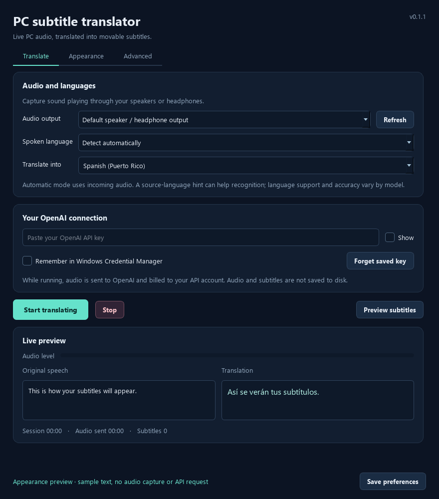

# PC Subtitle Translator

A Windows desktop app that listens to the sound playing through a selected speaker or headphone output, recognizes speech with OpenAI, and displays translated subtitles in a movable overlay.

Version 0.1.1 · Windows x64 · Python 3.12–3.14 · MIT license · Alpha

[Download the portable Windows app](https://github.com/NaN-Error/pc-subtitle-translator/releases/latest) · [Run from source](#run-from-source) · [Testing](docs/TESTING.md) · [Development](docs/DEVELOPMENT.md) · [Changelog](CHANGELOG.md)




Screenshots are rendered with sample captions; they do not show a live API translation. More views: [appearance settings](docs/screenshots/appearance-settings.png) and [model settings](docs/screenshots/openai-model-settings.png).

## Requirements

- A 64-bit Windows PC with a speaker/headphone output available through WASAPI loopback.
- Internet access and your own OpenAI API key with billing and access to the chosen models.
- No separate Python installation for the portable download. Source setup requires 64-bit Python 3.12, 3.13, or 3.14.

The application captures live audio from a selected output device. It does not open media files, import/export SRT files, isolate individual applications, or save a transcript history. Audio and translation go through OpenAI, so this is not an offline translator.

## Start the portable app

1. Download **Subtitles.zip** from [Releases](https://github.com/NaN-Error/pc-subtitle-translator/releases/latest), then extract the **entire** archive into a short location, such as your Desktop. GitHub’s automatic source-code ZIP does not include the portable runtime.
2. Open the extracted `Sub` folder and double-click **Start.bat**. Do not run it from inside the ZIP.
3. On the **Translate** tab, paste your **OpenAI API key**. Leave **Remember in Windows Credential Manager** unchecked for session-only use, or check it to save the key in Windows' credential vault.
4. Select the audio output where your video, game, meeting, or other application is playing.
5. Set **Spoken language** to **Detect automatically**, or choose the language you expect to hear. Set **Translate into** to your desired language.
6. Press **Start translating**, then play the content on your PC.
7. Drag the subtitle window to the desired position. Use its **far-right play/pause button** to stop and resume translation.

The portable download includes its own Python runtime and dependencies. It does not need a separate Python installation, a microphone, a virtual audio cable, or administrator access. It still needs an internet connection and an OpenAI API project with access to the selected models.

**Status of this build:** Alpha. Publication checks on Windows 11 passed **103 automated tests**, with **6 skipped** cases that require filenames Windows cannot create. The bundled Python runtime and core libraries loaded, and four sample Qt views rendered offscreen. Real WASAPI hardware, native desktop interactions, Windows Credential Manager, and paid OpenAI requests remain unverified. See [testing and acceptance checks](docs/TESTING.md) and the [publication verification record](docs/publication-verification.json). The original Linux build record remains in [verification.json](docs/verification.json).

If the window does not open, run **Debug.bat** from the portable folder to see startup errors. The full application source is included in `app/`.

The release also includes `Subtitles.zip.sha256`. To check the download in PowerShell, run `Get-FileHash .\Subtitles.zip -Algorithm SHA256` and compare its hash with that text file.

### Windows extraction fix in 0.1.1

The original portable ZIP contained a 198-character internal path. A normal Downloads path plus the extra extraction folder could exceed Windows' classic full-path limit. This package uses the shorter `Sub/r/p` layout and omits four unused static Qt build object files; all runtime DLLs, plugins, audio packages, assets, and licenses are retained. The builder now rejects internal paths longer than 128 UTF-16 units. The current longest path is 126.

Extract this version into a **new folder** instead of merging it with an incompletely extracted 0.1.0 copy. A Desktop folder, or another short folder you can write to, is suitable. You do not need to enable long paths in the registry. Avoid placing the app inside a deeply nested folder; the destination still contributes to the total path length.

The audio, translation, and subtitle features are unchanged. Publication checks now establish Windows runtime imports and offscreen tests; they do not establish native desktop interaction or live audio/API behavior.

## Included features

| Feature | Behavior |
| --- | --- |
| PC audio capture | Windows WASAPI loopback captures the selected speakers/headphones. |
| Source language | Automatic recognition, a dropdown of common languages, or a custom language code. |
| Target language | Choose from the dropdown or type a language/region, such as Spanish (Puerto Rico). |
| OpenAI API key | Masked entry; optional Windows Credential Manager storage; forget-key action. |
| Model selection | Separate OpenAI model dropdowns for speech recognition and text translation. |
| Live subtitles | Speech is streamed; short finalized segments are translated with streaming text output. |
| Subtitle placement | Drag the overlay; remembered position; reset-position control. |
| Play/pause on subtitles | A control at the far right stops capture and requests, then starts a new live session on resume. |
| Text area | Adjustable width and height; corner resizing; long text wraps within the chosen area. |
| Font controls | Installed-font picker, font size, text color, and background opacity. |
| Original speech | Optional smaller source text alongside the translation. |
| Click-through mode | Lock the text overlay; the play/pause control stays interactive. |
| Preview | Sample captions without audio capture or an API request. |
| Recovery | Bounded queues, ordered transcripts, clear errors, and limited reconnection attempts. |

## Audio routing

Choose the **output device**, not an application. All sound mixed into that output may be captured. If a browser plays through headphones while the selected device is your monitor speakers, the app will not hear that browser. Windows' volume mixer can route applications to the same output.

The **Follow the Windows default output at Start** option resolves the default when a session starts. After changing headphones, connecting Bluetooth audio, or switching the default output, pause, refresh the list if needed, and start again.

This version does not isolate one application's audio and does not mix multiple output devices simultaneously. It deliberately does not fall back to a microphone. Protected audio paths or exclusive device access may prevent loopback capture.

## Language and model settings

Automatic mode leaves the source-language hint unspecified. Audio is recognized as it arrives; there is no separate language-detection recording step. Choosing a source language sends that hint to the transcription service. The service still needs to hear the words, and the hint is not a guarantee that every accent or language will be recognized correctly.

The default live model does not report a detected-language label. Accordingly, the interface shows **Detect automatically**, without inventing a detected-language indicator. This follows the [OpenAI live transcription guide](https://developers.openai.com/api/docs/guides/realtime-transcription).

The target field is editable so it can express languages and regional preferences beyond the built-in choices. Actual coverage, accuracy, and model access depend on OpenAI; no model supports every human language equally.

Default models:

| Stage | Default | Purpose |
| --- | --- | --- |
| Speech recognition | `gpt-live-transcribe` | Receives the streamed PC audio and produces source text. |
| Translation | `gpt-6-luna` | Translates source segments into your target language. |
| Translation reasoning | `none` | Avoids unnecessary reasoning delay for this focused task. |

Other listed recognition options include `gpt-transcribe`, `gpt-4o-mini-transcribe`, and `gpt-4o-transcribe`. The translation dropdown also includes `gpt-5.4-mini`. Editable model fields allow a compatible **OpenAI model ID**. The program always uses OpenAI's official endpoints; it has no third-party provider URL option.

A model appearing in the dropdown does not guarantee that your project can access it. If you choose a custom text model that does not accept `reasoning`, change **Reasoning effort** to **omit**. Prefer **none** when supported; larger reasoning settings can make subtitles late. Model and language changes take effect on the next start. Font and appearance changes apply immediately.

Primary model references: [GPT Live Transcribe](https://developers.openai.com/api/docs/models/gpt-live-transcribe), [GPT-6 Luna](https://developers.openai.com/api/docs/models/gpt-6-luna).

## Timing and readability

This is near-real-time translation. The default segment ends after approximately **450 milliseconds of quiet** or a maximum of **3 seconds** of audio. It then waits for the final source transcript and streams the translation as it is generated. Network and model processing add delay. There is no measured end-to-end latency claim for this build.

In **Advanced**:

- Lower **Maximum segment** for more frequent translations. This provides less sentence context and makes more requests.
- Raise it for more context and fewer requests, at the cost of later captions.
- Lower **Pause before translating** to respond more quickly to a pause.
- Make **Quiet-audio threshold** more negative to recognize quieter speech.
- Add a short **Vocabulary or subject hint** for technical terms or names.

The local gate detects audio energy, not the meaning of speech. Music, effects, and noise can keep it open. The maximum segment length still advances subtitles during continuous audio. Queues are bounded; when the service falls behind, the app reports skipped segments instead of silently accumulating a long delay.

The subtitle area displays the newest lines that fit its width, height, and font. The complete current caption remains in the main **Live preview**. It is not a transcript history. If text is too large to fit comfortably, increase the area or reduce the font size.

**Pause** closes the live connection and stops capture, rather than merely hiding captions. Audio played while paused is not replayed when you resume. A request already accepted by OpenAI may still be billable after cancellation. **Hide subtitles** only changes visibility; use pause to stop translation.

For games, a regular desktop overlay generally requires windowed or borderless mode. Exclusive full-screen games, elevated applications, other topmost windows, and protected playback need on-device testing. No game injection or anti-cheat integration is used.

## API cost and data handling

Usage is charged to the API project behind the entered key. The program does not include credit or a subscription.

At the official published prices checked on October 24, 2026, `gpt-live-transcribe` costs **$0.017 per submitted audio minute**. Sixty submitted minutes therefore cost **$1.02 for transcription**, plus text translation. `gpt-6-luna` lists standard text prices of **$0.10 per million input tokens** and **$0.50 per million output tokens**. Actual usage varies with speech, context, selected model, and account pricing. See the [audio model price](https://developers.openai.com/api/docs/models/gpt-live-transcribe) and [text model price](https://developers.openai.com/api/docs/models/gpt-6-luna), and use your [API usage dashboard](https://platform.openai.com/usage) as the billing record.

The on-screen **Audio sent** counter measures bytes submitted by this app. It is not an invoice or a guaranteed savings estimate. Quiet audio may be withheld locally, but background music may still be submitted.

Audio goes directly to OpenAI while translation is running. Audio and captions are kept in memory; this app does not write recordings or transcript logs. Responses requests set `store: false`, which does not by itself promise zero provider retention. OpenAI's applicable account data controls still govern its service.

Preferences are stored in `%APPDATA%\PcSubtitleTranslator\settings.json`. API keys are excluded from that JSON. Optional key persistence uses **Windows Credential Manager**, with no plaintext fallback. An `OPENAI_API_KEY` environment variable is also recognized, taking precedence at launch. If that variable exists, the forget button cannot remove it from your Windows environment; remove it there separately if desired.

## Run from source

For editing or development, install 64-bit **Python 3.12, 3.13, or 3.14** on Windows. Clone this repository and run the setup scripts from its root:

```bat
git clone https://github.com/NaN-Error/pc-subtitle-translator.git
cd pc-subtitle-translator
```

Alternatively, download GitHub’s source-code ZIP and extract it, then open the extracted folder. Run:

```bat
setup_windows.bat
start_windows.bat
```

Setup creates a local `.venv`, downloads pinned dependencies, and verifies the dependency set. It does not install Python or request administrator access. Once setup completes, use `start_windows.bat` for later runs.

To preview without API calls:

```bat
start_windows.bat --demo
```

The Python entry point is:

```text
python -m pc_subtitle_translator
```

Optional `build_windows.bat` builds a PyInstaller folder on Windows. `scripts/build_portable.py` assembles the portable distribution using the official embeddable runtime and prebuilt, hash-verified wheels; it can run on Linux without executing Windows binaries. See `docs/DEVELOPMENT.md`.

## Troubleshooting

| Symptom | What to check |
| --- | --- |
| No window after Start.bat | Extract the whole ZIP and run Debug.bat for the actual error. |
| No audio level | Select the output that is playing the content; confirm the content is not muted. |
| Level moves but no subtitles | Check API errors and model access; try clearer speech or a lower quiet threshold. |
| Unsupported language/model error | Choose a supported source code/model; auto mode can avoid a wrong source hint. |
| API key rejected | Check the API key and project permissions; a website login is not an API key. |
| Rate limit or quota error | Check your API billing/limits; increase maximum segment length to reduce request frequency. |
| Text is late | Reduce segment length, keep reasoning at none, and check network performance. |
| Some captions skipped | The service is behind; a bounded queue is dropping old work. Adjust timing/model settings. |
| Wrong subtitles during music | The energy gate can detect music; use clearer voice audio or a stronger quiet threshold. |
| Cannot drag locked text | Unlock it in Appearance. The far-right play/pause button remains clickable. |
| Subtitle window off-screen | Use Appearance → Reset position. |
| Can't save API key | Leave Remember off and use the key for this session; check Windows Credential Manager. |
| Game covers subtitles | Use borderless/windowed mode. |

See `docs/TESTING.md` for the remaining Windows acceptance checks, and `docs/ARCHITECTURE.md` for implementation details.


## Repository guide

| Path | Contents |
| --- | --- |
| `pc_subtitle_translator/` | Application source: GUI, overlay, audio capture, streaming translation, settings, and credentials. |
| `scripts/` | Portable distribution builder, PyInstaller launcher, and sample screenshot renderer. |
| `tests/` | Synthetic audio, mocked API transports, settings, UI, and packaging tests. |
| `docs/ARCHITECTURE.md` | Data flow, threading, bounded queues, and error handling. |
| `docs/DEVELOPMENT.md` | Development setup and Windows packaging instructions. |
| `docs/TESTING.md` | Automated coverage, remaining limits, and manual acceptance checklist. |
| `requirements.txt` / `requirements-dev.txt` | Pinned runtime and development dependencies. |

The Git repository contains source and documentation. Bundled Python, native dependencies, launchers, third-party licenses, and the file manifest are supplied in the portable release download.

## Contributing and support

Report reproducible bugs or request features through [GitHub Issues](https://github.com/NaN-Error/pc-subtitle-translator/issues). Include the program version, Windows version, selected device/model, reproduction steps, and a redacted error message. Never post API keys, private recordings, or unredacted account information. See [CONTRIBUTING.md](CONTRIBUTING.md) for development checks.

## License

The application source retains its included [MIT license](LICENSE). Third-party runtime and library components retain their own licenses; see [THIRD_PARTY_NOTICES.txt](THIRD_PARTY_NOTICES.txt) and the portable download’s `licenses/`, `r/LICENSE.txt`, and `r/p/*.dist-info/` directories. This project uses the OpenAI API and is not an official OpenAI application.
